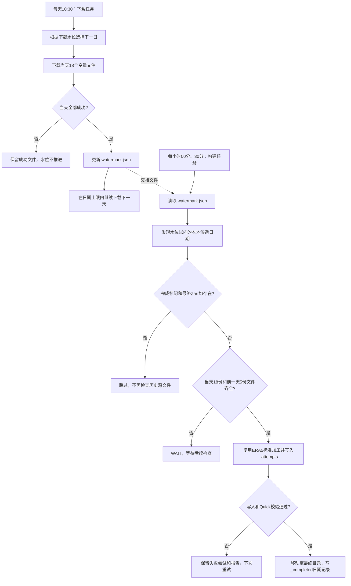

# Tongyun：ERA5 每日下载与日 Zarr 自动构建运行手册

更新日期：2026-11-06。代码分支：`feature/tongyun-inference-dataset-building`。

本文对应当前的“下载水位驱动构建”实现，使用服务器实际路径。
服务器是否已运行最新实现，取决于代码和配置是否已同步；保存了cron不等于已经成功生成产物。
本文不会把历史示例日期当作当前服务器已完成日期。

## 1. 当前流程与边界

两个独立的cron任务组成流水线：下载任务每天10:30启动，Zarr任务每30分钟检查一次。
下载器完成某个UTC日后写入下载水位；构建器在水位允许的范围内查找尚未生成的日产品。



这里的“实时”是新日数据就绪后由定时检查触发构建，不是文件流式写入，也不是即时回调。
同一天18份文件仍未完成时，不会生成该日的部分Zarr。下载下一天与构建上一天可以同时进行。
当前自动化止于日Zarr发布，尚未自动执行模型推理、选择两帧历史或更新展示页面。

## 2. 服务器目录与关键代码

| 用途 | 服务器位置 |
| --- | --- |
| 下载器仓库 | `/home/xmetai/xmetai-datakit-download` |
| 构建器仓库 | `/home/xmetai/xmetai-datakit` |
| Python | `/home/xmetai/anaconda3/envs/zjf/bin/python` |
| 数据根目录 | `/home/xmetai/era5_download/era5_tongyun_c78` |
| 每日原始文件 | 数据根目录下 `raw/daily` |
| 下载记录 | 数据根目录下 `raw/_records/tongyun_c78_daily` |
| 最终日Zarr | 数据根目录下 `zarr/era5.YYYYMMDD.c78.p25.h6.v1` |
| 构建成功记录 | 数据根目录下 `zarr/_completed/YYYYMMDD.json` |
| 尝试构建的目录 | 数据根目录下 `zarr/_attempts/<随机ID>/<产品名>` |
| 构建JSON报告 | 数据根目录下 `reports` |
| 统计量及静态附件 | `/home/xmetai/stats/tongyun_c78` |
| 运行日志 | `/home/xmetai/logs/xmetai-era5-tongyun` |

下载入口是下载器仓库中的 `examples/dataset_downloader/cds_download/run_tongyun_c78_daily.py`。
以下路径相对于构建器仓库：

| 文件 | 职责 |
| --- | --- |
| `examples/dataset_building/build_ready_tongyun_days.py` | 读取下载水位、筛选日期、跳过已完成产物、发布与记录 |
| `examples/dataset_building/example_build_tongyun_daily.py` | 按日限定输入文件与时间范围，调用现有ERA5入口 |
| `examples/dataset_building/example_build_era5.py` | 原始变量读取、六小时累计、打包、单位加工和归一化 |
| `examples/dataset_building/tongyun_daily_server.yaml` | 服务器数据路径和附件路径 |
| `config/data_sources/era5_cds_daily_raw.yaml` | 每日文件布局、变量映射、时间语义 |
| `config/dataset_specs/era5_c78_p25_h6.yaml` | 标准c78产品结构、类型、附件和校验要求 |
| `pipelines/dataset/build.py` | 通用构建编排、写入、附件复制与落盘Quick校验 |
| `pipelines/dataset/validate.py` | 校验实现，默认内存预算8192 MiB |

## 3. 下载器如何计算日期

下载器使用服务器本地日期计算请求日期，数据文件表示UTC日；当前服务器时区为北京时间。

| 情况或参数 | 当前默认行为 |
| --- | --- |
| 存在下载水位 | 从 `latest_complete_day + 1天` 开始 |
| 不存在下载水位 | 从运行当天减7天开始，`--bootstrap-days-ago 7` |
| 最晚尝试日期 | 运行当天减3天，`--minimum-lag-days 3` |
| 单次最多尝试 | 10个日期，`--max-catchup-days 10` |
| `--date YYYY-MM-DD` | 只处理显式指定日期，不执行常规日期追赶 |

日期上限只是请求限制，不保证CDS已经发布该日所有变量。遇到某日请求失败时，当前运行停止
日期推进。下载成功后水位只向前更新，手动补更早日期不会把已有水位往回移动。

首次没有水位时，如果隔天重新启动，会重新计算“当天减7天”，并不固定最初的起始日期。
如需确保某个早期日期被补齐，使用显式 `--date`，不要手动伪造下载水位。

## 4. 每天18个变量、78个通道

| 组 | 变量 | 请求/文件数 | 时次 |
| --- | --- | ---: | --- |
| 高空 | z、t、u、v、q，各13层 | 5 | 00/06/12/18 UTC |
| 地面瞬时 | t2m、d2m、sst、u10m、v10m、u100m、v100m、msl | 8 | 00/06/12/18 UTC |
| 地面累计 | ssr、ssrd、fdir、ttr、tp | 5 | 00–23 UTC逐小时 |

气压层：50、100、150、200、250、300、400、500、600、700、850、925、1000 hPa。
高空展开后为65通道，地面为13通道，合计78通道。

```text
raw/daily/
├── pl_h6/<CDS变量名>/<年份>/<CDS变量名>_YYYYMMDD.nc
├── sfc_inst_h6/<CDS变量名>/<年份>/<CDS变量名>_YYYYMMDD.nc
└── sfc_accum_h1/<CDS变量名>/<年份>/<CDS变量名>_YYYYMMDD.nc
```

例如 `pl_h6/temperature/2026/temperature_20261030.nc` 包含该变量的13层和4个时次，
不是一层一个文件。累计变量需要24小时资料用于后续六小时求和。

## 5. 下载完成状态与续传

当前每日下载器使用2个工作线程，每个线程经历提交请求、等待CDS、传输文件，再执行下一个变量。
CDS等待期间也占用线程。脚本级重试次数为0，但CDS客户端仍可能内部重试；
日志中的“attempt ... of 500 / Retrying in 120 seconds”属于客户端，不能用脚本重试参数解释。

文件先写 `.nc.part`，客户端返回成功且临时文件存在后，替换为正式 `.nc`，再写成功日志。
`status.jsonl` 追加记录 `started/completed/failed`；它仍供下载器判断任务续传，Zarr构建器已不再读取它。

下载任务只有“成功记录存在且正式文件存在”才会跳过。失败或缺失文件会再次处理。
程序重启后未完成的 `.part` 会重新开始；同一次运行中的客户端可能续传，不应反复重启来提速。

CDS日志的 `accepted` 是服务端接受请求，`successful` 是服务端结果准备完成；
本地完成以下载器 `completed` 为准。无 `.part` 可能仍处于服务端等待阶段，不能单独据此判断卡死。

## 6. 下载水位和Zarr成功记录的分工

下载水位完整路径：

```text
/home/xmetai/era5_download/era5_tongyun_c78/raw/_records/tongyun_c78_daily/watermark.json
```

示例（不是当前服务器状态）：

```json
{"latest_complete_day": "2026-10-30"}
```

当天18个任务全部成功后，下载器才通过临时文件替换方式更新水位。首日未完成时水位可不存在。
这是下载完成边界，不代表文件内部已通过科学质量验收，也不代表Zarr已生成。

Zarr构建成功记录位于 `zarr/_completed/YYYYMMDD.json`，内容示意：

```json
{
  "date": "2026-10-30",
  "destination": "/home/xmetai/era5_download/era5_tongyun_c78/zarr/era5.20261030.c78.p25.h6.v1",
  "source": "/home/xmetai/era5_download/era5_tongyun_c78/raw/daily",
  "completed_at": "<实际UTC完成时间>"
}
```

完成标记由自动构建任务管理。单独手动调用 `example_build_tongyun_daily.py` 不会写该标记。

## 7. 构建器如何选择日期

每次启动读取一次下载水位；文件不存在时输出WAIT并正常退出，日期格式错误则报错。
构建器扫描 `pl_h6/temperature/*/temperature_*.nc` 文件名，提取日期，保留不晚于水位的日期。
候选日期按从早到晚排序，排除 `.part` 和无法解析日期的文件名。

对每个候选日依次执行：

1. 检查最终Zarr目录和 `_completed` 日期文件，两者都有就SKIP，不再检查该日23份源文件。
2. 对未完成日期，检查目标日18份文件以及前一天5份累计量文件是否存在。
3. 缺文件就WAIT，继续查看后面的候选日期；内部变量、时间、网格和缺测由后续构建器验收。
4. 最终目录存在但没有成功标记时，报告ERROR并拒绝覆盖，需人工核对报告和产物。
5. 每次默认最多尝试构建1个就绪日期；`--max-days 3` 表示最多尝试3个，不保证全部成功。

已完成日期仍涉及文件名发现和标记判断，但不会重新检查全部原始文件或读取历史大数组。
水位一次推进多天也不会只处理最新一天；后续运行继续补建遗漏日期。
如果一次构建失败，仍会消耗本次尝试额度；默认1天时，该早期失败日期可能反复优先重试，
需要及时查看失败报告，而不能认为后续就绪日期一定会自动越过失败任务。
源文件不存在的日期则会直接WAIT，不消耗构建尝试额度。

## 8. 为什么生成一天需要23份源文件

完整日包含00/06/12/18 UTC四帧。累计量窗口使用右端标记，即T-5小时至T的六个小时量求和。

| 输出时刻 | 需要的逐小时累计量 |
| --- | --- |
| 当天00 UTC | 前一天19–23 UTC，加当天00 UTC |
| 当天06 UTC | 当天01–06 UTC |
| 当天12 UTC | 当天07–12 UTC |
| 当天18 UTC | 当天13–18 UTC |

因此除当天18份文件，还需要前一天ssr/ssrd/fdir/ttr/tp共5份文件。
如果第一次从10月29日开始下载，没有10月28日边界资料，10月29日不会生成完整日Zarr；
待10月30日下载完整，即可用10月29日累计资料构建10月30日。
如需构建最初一天，应补下载其前一天累计资料，不应删除零时次或补零绕过缺失检查。

## 9. 当前实际加工与Zarr结构

按本次约定沿用 `example_build_era5.py` 和标准c78契约，不增加先前讨论的Tongyun专用填值/单位分支。
读取时先为各变量保留独立时间轴，避免瞬时量与逐小时量提前合并后插入NaN。
随后选择瞬时量时次、检查六小时窗口完整性、求和、按标准层和通道顺序打包。

现有加工包括：q乘1000；六小时辐射累计转W/m²；tp转mm、非负裁剪并log1p；
再使用指定mean/std执行z-score。它不是先前讨论的6h Wh/m²物理域输入，
也没有新增sst填287.066 K的分支。缺测与质量按当前构建契约报告，不能把失败视为已自动修复。
mean/std必须与这一加工域匹配，按日入口要求固定统计量，不从当日重新计算。

```text
data(time, channel, lat, lon)
shape = (4, 78, 721, 1440)
dtype = float16（加工主数据使用float32，按契约转换落盘类型）
time = 当天00、06、12、18 UTC
lat = 90 → -90，间隔0.25°
lon = 0 → 359.75，间隔0.25°
```

主数组按time=1、其余维度full分块；单块未压缩约154.5 MiB。
标准数组还包括mean、std、mask及相应坐标；const.nc和weight.npy按附件规则复制。
Zarr是目录产品，不是一个同名NC文件。后续推理读取方式和归一化约定需要单独对接。

## 10. 写入、Quick校验与发布

按日入口用临时符号链接暴露所需23份文件，不复制或修改原始文件。
临时链接目录随调用结束清理，报告中的源检查路径可能指向已清理的链接目录；
真实源目录记录在完成标记中。

正式构建先写 `zarr/_attempts/<随机ID>/<产品名>`，复制附件并执行落盘Quick校验。
只有构建器返回写入和Quick成功，才把该产品目录移动至 `zarr/<产品名>`，
随后原子写入完成记录，输出READY。原报告中的目标路径仍指向该次attempt，
完成记录的destination指向最终位置。

当前校验默认内存预算8192 MiB（8 GiB），这是检查阈值，不是预分配内存，也不是磁盘容量。
写入完成后会关闭源数据、释放局部引用并执行垃圾回收，再开始落盘检查。
Quick通过不等价于全量扫描或完整发布验收通过。需进一步验收时使用独立full验证流程。

构建失败不写完成标记，失败attempt和报告保留，下次使用新attempt重试，不覆盖已有目录。
若进程在目录发布后、写标记前退出，会留下“最终目录有、成功标记无”的状态；
此时应检查原报告和最终产物后人工恢复，不要盲目补一个成功标记。

## 11. 当前服务器配置

文件：`examples/dataset_building/tongyun_daily_server.yaml`。

```yaml
source: /home/xmetai/era5_download/era5_tongyun_c78/raw/daily
download_watermark: /home/xmetai/era5_download/era5_tongyun_c78/raw/_records/tongyun_c78_daily/watermark.json
output_root: /home/xmetai/era5_download/era5_tongyun_c78/zarr
report_dir: /home/xmetai/era5_download/era5_tongyun_c78/reports
mean_nc: /home/xmetai/stats/tongyun_c78/mean.nc
std_nc: /home/xmetai/stats/tongyun_c78/std.nc
mask_nc: /home/xmetai/stats/tongyun_c78/mask.nc
const_nc: /home/xmetai/stats/tongyun_c78/const.nc
weight_npy: /home/xmetai/stats/tongyun_c78/weight.npy
```

两份仓库共同使用同一数据根目录，构建源路径和下载器输出路径必须一致。
下载器依赖CDS凭据及下载客户端；构建器还需要当前仓库声明的IO、Dask、Zarr等依赖。
当前代码要求Zarr 3，旧版Zarr可能报 `unexpected keyword argument 'zarr_format'`。
不要用修改校验预算来处理依赖不兼容。

## 12. 首次验证与手动运行

在目标服务器执行：

```bash
cd /home/xmetai/xmetai-datakit
ls -lh /home/xmetai/stats/tongyun_c78/{mean.nc,std.nc,mask.nc,const.nc,weight.npy}

/home/xmetai/anaconda3/envs/zjf/bin/python -u \
  -m examples.dataset_building.build_ready_tongyun_days \
  --config examples/dataset_building/tongyun_daily_server.yaml --dry-run
```

dry-run不写Zarr、不写完成标记、不执行落盘Quick，但会在有就绪日期时读数据、加工、检查并保存报告。
如果只输出WAIT或No new ready days，说明没有实际验证加工链路，不应把它当作完整dry-run通过。

准备正式创建就绪日产品时，使用构建锁：

```bash
cd /home/xmetai/xmetai-datakit
/usr/bin/flock -n /tmp/xmetai-era5-tongyun-zarr.lock \
  /home/xmetai/anaconda3/envs/zjf/bin/python -u \
  -m examples.dataset_building.build_ready_tongyun_days \
  --config examples/dataset_building/tongyun_daily_server.yaml --write
```

自动构建器默认按日期顺序处理，可能先遇到比预期更早的就绪日期。
手动调用指定日入口可定位单日问题，但不会产生自动任务的完成标记；
排查时优先使用dry-run或明确隔离输出，不向自动任务的最终目录随意手工写产物。

## 13. 当前crontab

已确认的两条命令如下，每条必须占完整一行；cron使用服务器本地时区。
使用Python绝对路径，不需要cron先执行conda activate。

```bash
mkdir -p /home/xmetai/logs/xmetai-era5-tongyun
crontab -e
```

```cron
30 10 * * * /usr/bin/flock -n /tmp/xmetai-era5-tongyun.lock /home/xmetai/anaconda3/envs/zjf/bin/python -u /home/xmetai/xmetai-datakit-download/examples/dataset_downloader/cds_download/run_tongyun_c78_daily.py >> /home/xmetai/logs/xmetai-era5-tongyun/daily-download.log 2>&1
*/30 * * * * cd /home/xmetai/xmetai-datakit && /usr/bin/flock -n /tmp/xmetai-era5-tongyun-zarr.lock /home/xmetai/anaconda3/envs/zjf/bin/python -u -m examples.dataset_building.build_ready_tongyun_days --config examples/dataset_building/tongyun_daily_server.yaml --write >> /home/xmetai/logs/xmetai-era5-tongyun/zarr-build.log 2>&1
```

保存自动生效，无需重启。任务是定时短进程检查，不是一直驻留的Zarr服务；
没有就绪数据时很快退出，ps查不到构建进程也可能完全正常。SSH退出不影响cron启动的任务。

两把锁不同：下载和构建可以并行，但各自不能重入。
如果昨天的下载仍运行，今天10:30新下载任务会因锁被占用而直接退出，不会重复下载。
构建超过30分钟时后续触发也会跳过，等待下次；`flock -n`跳过本身可能不追加业务日志。
锁文件存在不代表锁被占用，进程退出会自动释放锁，无需删除锁文件。

## 14. 日常检查命令

确认任务和服务：

```bash
crontab -l
systemctl is-active cron
sudo journalctl -u cron --since today --no-pager
```

`CMD`记录说明cron触发命令，不代表下载或构建成功。服务inactive时由管理员启动cron。

查看两类运行日志：

```bash
tail -n 80 /home/xmetai/logs/xmetai-era5-tongyun/daily-download.log
tail -f /home/xmetai/logs/xmetai-era5-tongyun/zarr-build.log
```

`tail -f`中的Ctrl+C只退出日志查看，不会停止任务。
直接前台运行且未重定向的下载输出不会自动出现在cron日志中。

查看下载和构建完成状态：

```bash
cat /home/xmetai/era5_download/era5_tongyun_c78/raw/_records/tongyun_c78_daily/watermark.json
tail -n 20 /home/xmetai/era5_download/era5_tongyun_c78/raw/_records/tongyun_c78_daily/status.jsonl
ls /home/xmetai/era5_download/era5_tongyun_c78/zarr/_completed/
cat /home/xmetai/era5_download/era5_tongyun_c78/zarr/_completed/20261030.json
```

最后一条的日期应替换为已生成日期；不存在不一定是错误，也可能还未完成。

查看进程和资源：

```bash
pgrep -af '[r]un_tongyun_c78_daily.py'
pgrep -af '[b]uild_ready_tongyun_days'
free -h
df -h /home/xmetai/era5_download
du -sh /home/xmetai/era5_download/era5_tongyun_c78/{raw,zarr,reports}
```

pgrep输出可能包含Shell、flock、Python三层，不代表有三个独立下载实例。

## 15. 构建日志解释与常见问题

| 日志或现象 | 含义与处理 |
| --- | --- |
| `WAIT: ... watermark missing` | 尚无下载完整日或配置路径错误；核对下载记录和配置，不手工伪造水位 |
| `Download watermark: ...` | 当前启动读取的下载边界，本次运行不会自动刷新它 |
| `WAIT YYYY-MM-DD: missing daily/boundary files` | 当天或前一天累计量缺文件；首日常缺边界资料 |
| `BUILD` | 开始尝试构建，不等于已成功 |
| `READY` | 写入和Quick通过，最终目录及完成标记已发布 |
| `SKIP` | 完成标记和最终目录均存在，不再检查该日23份源文件 |
| `FAILED` | 查report和对应attempt；失败不写完成记录 |
| `ERROR ... output exists without a completion marker` | 未确认发布状态，拒绝覆盖；人工核对报告和产物 |
| `No new ready days to build` | 本次未尝试构建；可能都已完成，也可能缺文件，结合前面的WAIT/ERROR判断 |
| 日志文件不存在 | 可能cron未到触发时间、日志目录不存在、cron未运行或cd路径错误 |
| `Permission denied` | 目录写权限问题，不等于磁盘空间不足；检查目标目录归属 |
| `scan.memory_budget`失败 | 比较报告的实际进程内存、估算值与8 GiB预算，再检查机器可用内存 |
| `zarr_format`参数不识别 | 当前Python的Zarr依赖版本不匹配，不是数据或内存问题 |
| 下载长时间`accepted` | 核对CDS网页请求状态，不能只凭进程存活判断进度 |

失败报告保存在配置的report_dir，dry-run有执行构建时也会保存报告。
入口在检查附件路径或源文件前就失败时，可能只输出异常而没有构建JSON报告。

## 16. 暂停、恢复与数据保留

取消后续触发：执行 `crontab -e`，仅注释对应任务行，不要清空整个crontab。
已经运行的任务不会因删除cron自动停止。先用pgrep确认目标PID，再针对该PID发送TERM，
仅在无法正常退出时考虑KILL。不要通过宽泛的python进程名停止其他用户任务。

恢复cron后，下载器按水位和成功记录继续；构建器按下载水位、候选日及完成标记继续。
更改源文件、统计量或加工算法后，现有完成标记不会自动失效；需要新产品版本或单独安排重建，
不能期待已经SKIP的日期自动更新。

当前没有自动清理原始文件、失败attempt、空attempt父目录或日志的机制。
保留原始资料时要考虑下一天00时的边界依赖，重试较多时还要监控_attempts占用。
不要把删除旧数据作为默认修复操作，也不要删除完成标记后让程序覆盖已有最终目录。

## 17. 当前已确认状态与后续工作

用户已提供并确认下载和每30分钟构建的两条crontab完整命令。
此前构建dry-run只输出水位缺失WAIT，尚不能据此声称服务器真实数据加工、落盘及Quick已通过。
真正的单日端到端完成以服务器出现READY、最终Zarr及对应_completed记录为准。

下一阶段若接入推理，应消费最终目录和成功记录，不读取_attempts；
另行实现推理完成状态、跨日历史帧选择和展示发布机制，避免把Zarr成功误认为预报已更新。
